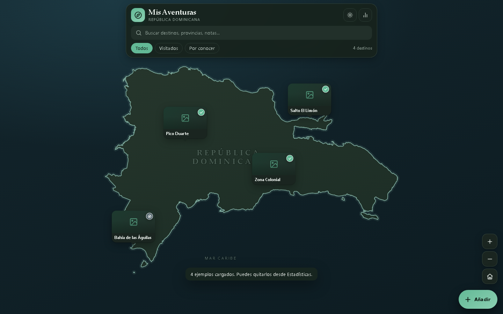

# Mis Aventuras RD

Aplicación web para llevar un diario de viaje por la República Dominicana: destinos visitados y por conocer, fotos, fechas, notas y presupuesto. Está pensada para publicarse como sitio estático y usarse siempre desde el navegador.



## Qué incluye

- **Mapa vectorial detallado** de la República Dominicana, con contorno costero, islas (Saona, Beata, Catalina, Alto Velo), etiquetas de ciudades y zoom/arrastre/pellizco.
- **Fichas de destinos** con provincia, localidad, estado, descripción, fechas, prioridad, notas y enlace de Google Maps.
- **Fotos por destino**: subida múltiple, cámara del móvil, arrastrar y soltar, pegar desde el portapapeles, compresión automática, portada, descarga, eliminación y visor a pantalla completa.
- **Presupuesto por categorías** con estimado y gasto real, diferencias y totales.
- **Estadísticas**: visitados, pendientes, provincias cubiertas, fotos, gasto y progreso.
- **Búsqueda sin acentos** y filtros por estado.
- **Modo claro/oscuro/automático**.
- **Datos locales**: IndexedDB con respaldo en `localStorage` cuando el navegador lo permite.
- **Copia de seguridad completa en ZIP**: comparte, exporta o importa destinos, presupuesto y fotos desde el menú de la tuerca. El importador también acepta los JSON antiguos.
- **Sin dependencias externas**: no usa CDN, fuentes remotas ni servicios de terceros. El lector/escritor de ZIP es propio.

## Publicar en GitHub Pages (recomendado)

Es la forma más simple de tener una URL HTTPS que funcione en Android, iPhone y computadora, sin servidor ni base de datos que configurar.

1. Crea un repositorio **público** en GitHub, por ejemplo `mis-aventuras-rd`.
2. Sube el contenido de esta carpeta tal cual: `index.html`, `assets/`, `README.md` y `docs/`. No hace falta compilar nada.
3. En el repositorio, entra en **Settings → Pages**.
4. En **Build and deployment**, elige **Deploy from a branch**.
5. Selecciona la rama `main` y la carpeta `/ (root)`. Guarda.
6. Espera uno o dos minutos. La app queda en:

   ```text
   https://tuusuario.github.io/mis-aventuras-rd/
   ```

7. Abre esa URL en el teléfono y usa **Añadir a pantalla de inicio** para tenerla a mano.

Notas:

- GitHub Pages sirve por HTTPS, que es lo que necesita el botón **Compartir**.
- No abras el `index.html` desde la vista de archivos de GitHub; usa la URL de Pages.
- Para actualizar, vuelve a subir los archivos cambiados.
- El repositorio puede ser público: la app no tiene claves ni secretos. Si lo quieres privado, GitHub Pages puede requerir un plan pago.
- Cada persona que abra la misma URL tiene **su propia copia** de los datos en su navegador. No es una base compartida ni hay cuentas.

### Otras opciones para publicar

- **Netlify Drop**, Vercel o Cloudflare Pages: arrastra la carpeta o el archivo único.
- **Un solo archivo**: `dist/mis-aventuras-rd.html` (o `dist/index.html`) contiene todo. Puedes subirlo solo a cualquier hosting estático.
- **Carpeta completa**: sube `index.html` y `assets/` tal como están. No requiere build ni servidor especial.

### Probar en local

Desde la carpeta del proyecto:

```bash
python -m http.server 8765
```

Y abre `http://127.0.0.1:8765/`. Para probar **Compartir** conviene usar `localhost` o HTTPS; abrir el archivo con doble clic (`file://`) puede desactivar el menú nativo de compartir.

## Dónde se guardan los datos

Los destinos y las fotos se guardan en **IndexedDB del navegador**. No hay cuentas, servidor ni sincronización automática entre dispositivos.

- **Tuerca → Compartir copia**: crea un ZIP y abre el menú nativo del teléfono (WhatsApp, Drive, Telegram, AirDrop…).
- **Tuerca → Exportar copia**: descarga el ZIP en el teléfono con el nombre `MisAventurasRD_AAAA-MM-DD_HH-MM-SS.zip`.
- **Tuerca → Importar copia**: abre el explorador de archivos y restaura un ZIP o un JSON antiguo.
- Al importar, la app muestra la fecha, los destinos y las fotos, y pregunta si quieres **Reemplazar todo** o **Combinar**.
- Si borras los datos del navegador o cambias de equipo sin exportar, los datos no se recuperan.
- Para sincronización real entre dispositivos haría falta añadir un backend (por ejemplo Supabase, Firebase o una API propia). Esta versión es local-first a propósito, para poder publicarse como sitio estático sin credenciales.

### Copia de seguridad en ZIP

El ZIP contiene:

```text
MisAventurasRD_2026-10-18_23-45-08.zip
├─ datos.json          # destinos, presupuesto y ajustes
├─ fotos/
│  └─ <destino>/
│     ├─ <foto>.jpg
│     └─ <foto>-min.jpg
└─ LEEME.txt
```

- Las fotos se guardan como archivos reales, no como base64. Así el ZIP es más liviano y las fotos se pueden ver o recuperar por separado.
- **Compartir** y **Exportar** generan la misma copia; la diferencia es que una abre el menú de compartir y la otra descarga el archivo.
- En Android funciona con Chrome/Edge. En iPhone funciona con Safari 15 o superior. Si el navegador no permite compartir archivos, el botón descarga el ZIP y avisa.
- Los navegadores dentro de WhatsApp, Instagram o Facebook a veces bloquean el menú de compartir. Si pasa, abre la app en Chrome o Safari.
- Las fotos ya están comprimidas por la app, así que el ZIP no las hará mucho más pequeñas; solo las agrupa. Una copia con muchas fotos puede pesar bastante.
- El importador valida el ZIP, revisa que sea de esta app y no borra nada hasta que confirmes.

## Fotos

- Se aceptan JPG, PNG, WebP, GIF y AVIF que el navegador pueda decodificar.
- Cada imagen se redimensiona a un máximo de 1600 px y se comprime a JPEG; se genera además una miniatura de 480 px.
- La primera foto de cada destino es la portada.
- Desde el visor puedes usar otra foto como portada, descargarla o eliminarla.
- Cuanto más grandes sean las fotos, más espacio ocuparán en IndexedDB. Puedes comprobar el uso en **Tuerca → Estadísticas y datos → Almacenamiento**.

## Mapa

El contorno vectorial se generó a partir de **geoBoundaries ADM0** (Caribbean GeoPortal, licencia CC BY 4.0) y se simplificó con Douglas-Peucker (tolerancia 0,0005°) para mantener detalle sin cargar un archivo enorme.

- Archivo de datos: `assets/js/geo-data.js` (~5.200 puntos).
- Proyección: Web Mercator.
- El texto de atribución aparece en **Tuerca → Estadísticas y datos**.

## Estructura

```text
mis-aventuras-rd/
├── index.html
├── build.mjs                 # genera la versión de un solo archivo
├── assets/
│   ├── css/styles.css
│   └── js/
│       ├── zip.js            # lector/escritor ZIP sin dependencias
│       ├── geo-data.js       # contorno de RD
│       ├── map.js            # motor del mapa
│       └── app.js            # estado, interfaz, fotos y datos
├── dist/
│   ├── index.html            # versión todo-en-uno para publicar
│   └── mis-aventuras-rd.html # la misma versión, con nombre descriptivo
└── README.md
```

## Desarrollo

No hay dependencias npm. Para regenerar el archivo único después de cambiar el código:

```bash
node build.mjs
```

El build incluye `zip.js` dentro del HTML final. El proyecto está pensado para navegadores modernos (Chrome, Edge, Firefox y Safari recientes). Usa `IndexedDB`, `Pointer Events`, `ResizeObserver`, `Intl`, `color-mix` y, para el ZIP, `Blob`, `FileReader`, `TextEncoder` y `DecompressionStream` cuando hace falta leer un ZIP comprimido.

## Privacidad

- Todo se procesa en el teléfono o la computadora. No se suben fotos ni destinos a ningún servidor.
- No hay analíticas, cookies de terceros, CDN ni fuentes remotas.
- La copia de seguridad solo sale del dispositivo cuando tú la compartes o la descargas.

## Créditos

- Mapa base: [geoBoundaries](https://www.geoboundaries.org/) / Caribbean GeoPortal, CC BY 4.0.
- Iconos: trazos propios inspirados en el estilo de Lucide (ISC).
